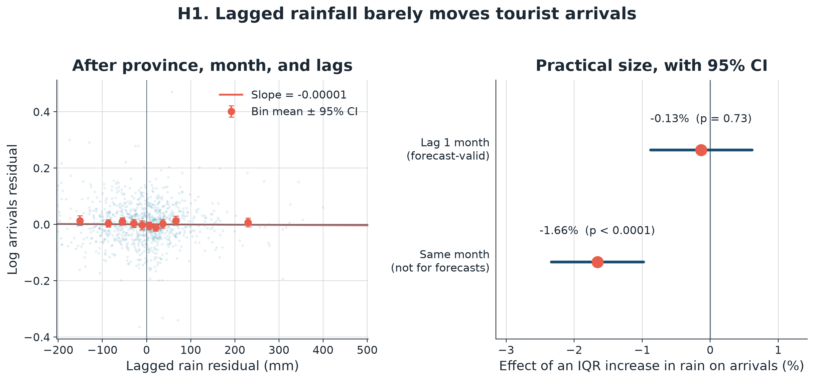
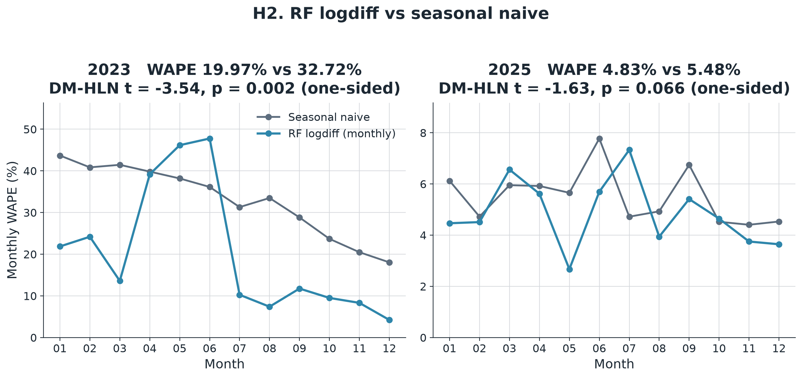
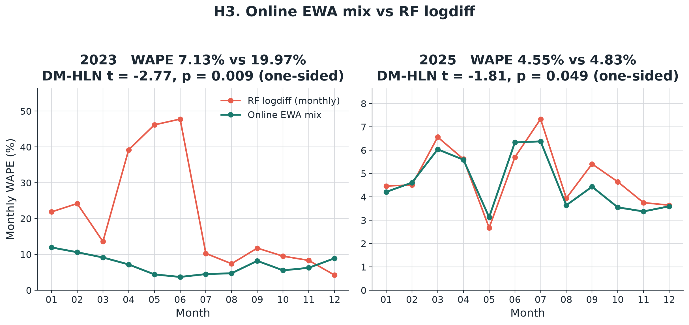
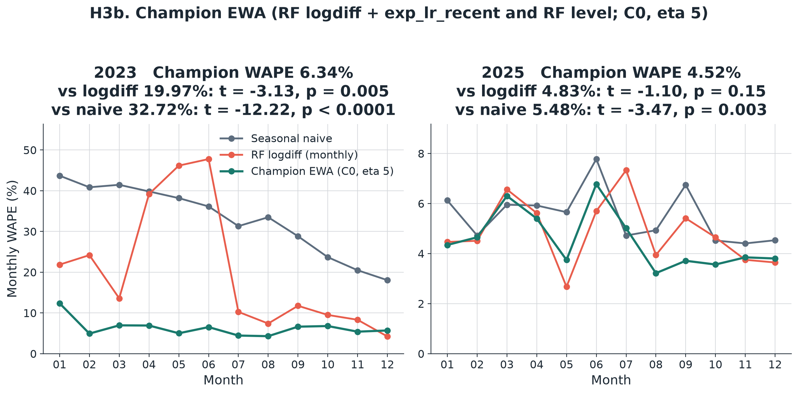
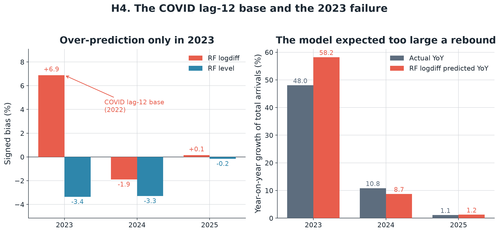
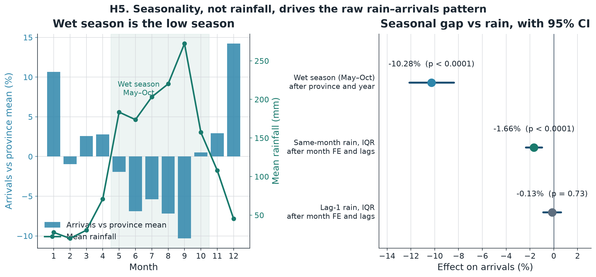
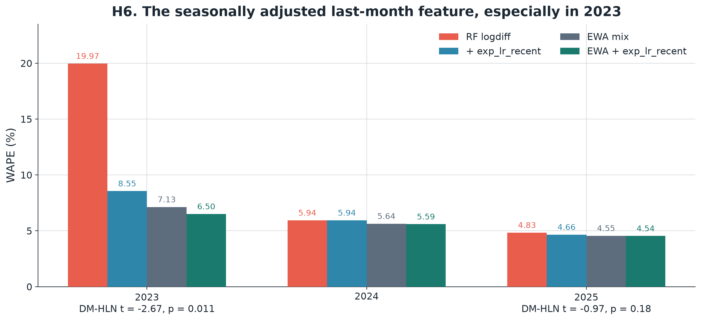

# Hypotheses and statistical tests

Project: **Tourist-Prediction-from-Raining** — monthly tourist arrivals for 77 Thai provinces (2018–2025) with rainfall, and online ML forecasts for 2023–2025.

This note states six hypotheses in plain language, the test used, and the result. Numbers other than H3b come from `/workspace/hypotheses/run_hypotheses.py`. H3b was re-run on the final Champion (C0 binary COVID flags, 2 experts, eta 5); the earlier eta-10 result is kept as a footnote in that section. Nothing in the repository was changed.

## Summary table

| Hypothesis | Test | Statistic | p-value | Conclusion |
|---|---|---|---|---|
| H1 lagged rain | Cluster-robust t (province clusters); controls: province FE, month FE, log lag-1 and lag-12 arrivals. Sample: 2019, 2024, 2025. | t = -0.35, ΔR² = 0.00005 pp, IQR effect = -0.13% | p = 0.73 | Do not reject H0: lagged rain is not statistically significant, but the effect is tiny — an IQR change in last month's rain is associated with a -0.13% change in arrivals (added R² = 0.00005 pp). |
| H1 same-month rain | Same specification, contemporaneous rain (not a valid forecast feature). | t = -4.75, ΔR² = 0.0077 pp, IQR effect = -1.66% | p < 0.0001 | Reject H0 at 5%: same-month rain has a statistically significant association after seasonality and lags, with an IQR effect of -1.66% (added R² = 0.0077 pp). This is a contemporaneous correlation, not a forecast result. |
| H2 RF logdiff vs naive (2023) | Diebold-Mariano on monthly sums of absolute errors, HLN correction, t(11). One-sided: RF better. | DM-HLN t = -3.54; WAPE 19.97% vs 32.72% | p = 0.002 (one-sided) | Reject H0 for 2023: RF logdiff is more accurate than seasonal naive (WAPE 19.97% vs 32.72%; DM-HLN t = -3.54, p = 0.002 one-sided). |
| H2 RF logdiff vs naive (2025) | Diebold-Mariano on monthly sums of absolute errors, HLN correction, t(11). One-sided: RF better. | DM-HLN t = -1.63; WAPE 4.83% vs 5.48% | p = 0.066 (one-sided) | Do not reject H0 for 2025: the WAPE gap (4.83% vs 5.48%) is not significant (DM-HLN t = -1.63, p = 0.066 one-sided). |
| H3 EWA mix vs RF logdiff (2023) | Diebold-Mariano on monthly sums of absolute errors, HLN correction, t(11). One-sided: EWA better. | DM-HLN t = -2.77; WAPE 7.13% vs 19.97% | p = 0.009 (one-sided) | Reject H0 for 2023: the online EWA mix is more accurate than RF logdiff (WAPE 7.13% vs 19.97%; DM-HLN t = -2.77, p = 0.009 one-sided). |
| H3 EWA mix vs RF logdiff (2025) | Diebold-Mariano on monthly sums of absolute errors, HLN correction, t(11). One-sided: EWA better. | DM-HLN t = -1.81; WAPE 4.55% vs 4.83% | p = 0.049 (one-sided) | Reject H0 for 2025: the online EWA mix is more accurate than RF logdiff (WAPE 4.55% vs 4.83%; DM-HLN t = -1.81, p = 0.049 one-sided). The two-sided p-value is p = 0.097, so this 5% one-sided result is borderline. |
| H3b champion vs RF logdiff (2023) | Diebold-Mariano on monthly sums of absolute errors, HLN correction, t(11). One-sided: champion better. Final Champion is C0 binary COVID flags, 2 experts (RF logdiff + exp_lr_recent 1m+3m and RF level), eta 5. | DM-HLN t = -3.13; WAPE 6.34% vs 19.97% | p = 0.005 (one-sided) | Reject H0 for 2023: the champion EWA mix is more accurate than RF logdiff (WAPE 6.34% vs 19.97%; DM-HLN t = -3.13, p = 0.005 one-sided). |
| H3b champion vs naive (2023) | Diebold-Mariano on monthly sums of absolute errors, HLN correction, t(11). One-sided: champion better. Final Champion is C0 binary COVID flags, 2 experts (RF logdiff + exp_lr_recent 1m+3m and RF level), eta 5. | DM-HLN t = -12.22; WAPE 6.34% vs 32.72% | p < 0.0001 (one-sided) | Reject H0 for 2023: the champion EWA mix is more accurate than seasonal naive (WAPE 6.34% vs 32.72%; DM-HLN t = -12.22, p < 0.0001 one-sided). |
| H3b champion vs RF logdiff (2025) | Diebold-Mariano on monthly sums of absolute errors, HLN correction, t(11). One-sided: champion better. Final Champion is C0 binary COVID flags, 2 experts (RF logdiff + exp_lr_recent 1m+3m and RF level), eta 5. | DM-HLN t = -1.10; WAPE 4.52% vs 4.83% | p = 0.15 (one-sided) | Do not reject H0 for 2025: the WAPE gap (4.52% vs 4.83%) is not significant (DM-HLN t = -1.10, p = 0.15 one-sided). |
| H3b champion vs naive (2025) | Diebold-Mariano on monthly sums of absolute errors, HLN correction, t(11). One-sided: champion better. Final Champion is C0 binary COVID flags, 2 experts (RF logdiff + exp_lr_recent 1m+3m and RF level), eta 5. | DM-HLN t = -3.47; WAPE 4.52% vs 5.48% | p = 0.003 (one-sided) | Reject H0 for 2025: the champion EWA mix is more accurate than seasonal naive (WAPE 4.52% vs 5.48%; DM-HLN t = -3.47, p = 0.003 one-sided). |
| H4 COVID base and 2023 failure | Difference-in-differences: (AE_logdiff − AE_level) in 2023 (COVID lag-12 base) vs 2024–2025; month-clustered t, one-sided. | t = 3.06; 2023 bias logdiff = +6.88% vs level -3.36%; predicted YoY 58.2% vs actual 48.0% | p = 0.001 (one-sided) | Reject H0: RF logdiff's extra absolute error relative to the level model is significantly larger in 2023, when every lag-12 base month is still inside the COVID window, and 2023 is the only year with a large positive bias (+6.88%). This is consistent with the COVID base/flag causing the 2023 failure; 2023 is the only such year we can test. |
| H5 seasonality dominates rain | Wet vs dry season after province and year FE (cluster-robust t); incremental R² of month FE vs rain after province and year FE. | Wet-season gap t = -10.18, effect = -10.3%; after province and year FE, ΔR² month = 0.33 pp (13.7% of residual) vs same-month rain 0.18 pp and lag-1 rain 0.09 pp | wet-season p < 0.0001; month ΔR² Wald p < 0.0001 | Reject the idea that rain is the main driver: wet-season months (May–Oct) have 10.3% lower arrivals after province and year effects (p < 0.0001). After those same controls, calendar month adds 0.33 pp of R² (13.7% of the remaining variation) versus 0.18 pp for same-month rain and 0.09 pp for lagged rain. Once month FE and lags are included, an IQR change in lag-1 rain is only -0.13%. |
| H6 exp_lr_recent vs RF logdiff (2023) | Diebold-Mariano on monthly sums of absolute errors, HLN correction, t(11). One-sided: new feature better. Models are nested; see caveats. | DM-HLN t = -2.67; WAPE 8.55% vs 19.97% | p = 0.011 (one-sided) | Reject H0 for 2023: RF logdiff + exp_lr_recent is more accurate than RF logdiff (WAPE 8.55% vs 19.97%; DM-HLN t = -2.67, p = 0.011 one-sided). |
| H6 exp_lr_recent vs RF logdiff (2025) | Diebold-Mariano on monthly sums of absolute errors, HLN correction, t(11). One-sided: new feature better. Models are nested; see caveats. | DM-HLN t = -0.97; WAPE 4.66% vs 4.83% | p = 0.18 (one-sided) | Do not reject H0 for 2025: the WAPE gap (4.66% vs 4.83%) is not significant (DM-HLN t = -0.97, p = 0.18 one-sided). |

One-sided p-values for forecast comparisons test whether the first named model is more accurate (lower absolute error). Two-sided p-values are reported in the sections below. WAPE figures are percentages.

## Data and methods

- **Panel:** 77 provinces × 96 months (January 2018–December 2025), from `experiments.new_features.run._load` on the project data. Arrivals are zero in 27 COVID months only; those rows are dropped from log-arrival regressions.
- **COVID window (project definition):** March 2020–December 2022. So every 2023 forecast has a lag-12 base month inside the COVID window (`is_covid_lag12 = True`); 2024 and 2025 do not.
- **Forecasts:** monthly-refit predictions in `/workspace/tpr-test/experiments/online_trials/predictions.parquet` (RF logdiff, RF level, seasonal naive, online EWA mix of logdiff and level). The `exp_lr_recent` (1-month + 3-month) feature forecasts are in `/workspace/data_review/pred_monthly_exp_lr_recent3_{2023,2024,2025}.csv`. Seasonal naive is last year's same-month arrivals (lag 12). The final Champion in H3b (C0, 2 experts, eta 5) is the EWA mix of the C0 logdiff and C0 level experts cached in `/workspace/tpr-test/experiments/online_replay/results/predictions.parquet`.
- **Rain regressions (H1, H5):** OLS on log arrivals with province and calendar-month (or year) fixed effects and lagged log arrivals. Standard errors are clustered by province. The **primary rain sample** is 2019, 2024 and 2025 (normal years, matching the earlier data review). A robustness sample adds 2023.
- **Forecast comparisons (H2, H3, H3b, H6):** Diebold-Mariano (DM) test on the 12 monthly sums of province-level absolute errors — the numerator of yearly WAPE — with the Harvey–Leybourne–Newbold (HLN) small-sample correction and a t(11) reference distribution, one-step horizon, no HAC lags. This is the slide-facing test (small T, but honest about common monthly shocks). We also report province-month loss differentials with standard errors clustered by month, by province, and two-way clustered.
- **Accuracy metric:** WAPE = Σ|pred − actual| / Σ actual. Signed bias = Σ(pred − actual) / Σ actual.
- **Wet season:** May–October, the usual southwest-monsoon definition for most of Thailand. The southern east coast is wetter later in the year; month fixed effects capture that without a special flag.

## H1. Lagged rainfall and arrivals

**H0:** After controlling for province, calendar month, and lagged arrivals (1 and 12 months), last month's rainfall has no effect on this month's arrivals.

**H1:** Last month's rainfall still has a significant effect.

**Primary sample:** 2695 province-months in 2019, 2024 and 2025.

Specification: `log(arrivals) ~ province FE + month FE + log(lag 1) + log(lag 12) + rain`.

- **Lag-1 rain (forecast-valid):** coefficient = -0.000007 per mm (cluster-robust SE 0.000021), t = -0.35, p = 0.73 (two-sided). Added R² = 0.00005 pp. Cluster-robust Wald F = 0.12, p = 0.73. Classical partial F = 0.32, p = 0.57. Gaussian LR = 0.33, p = 0.56 (LR is not cluster-robust).
- **Effect size:** an IQR increase in lag-1 rain (185.3 mm) is associated with a -0.13% change in arrivals (95% CI -0.88% to +0.62%). A one-SD increase (149.2 mm) corresponds to -0.11%.
- **Same-month rain (not used in the forecast model):** t = -4.75, p < 0.0001, added R² = 0.0077 pp, IQR effect = -1.66%.
- **Lag-1 rain anomaly** (mm vs the province's non-COVID median for that calendar month): t = 0.80, p = 0.42, added R² = 0.0002 pp.
- **Robustness, adding 2023:** lag-1 rain t = -0.36, p = 0.72, added R² = 0.00005 pp.
- **Raw (confounded) correlation** between log arrivals and same-month rain in the primary sample: 0.000. After residualizing on province, month, and lags, the partial correlation is -0.011.
- **Wettest vs driest contemporaneous rain-anomaly quintile** (mean residual of log arrivals after province, month, and lags): -0.0112 log points, or about -1.11% (unconditional on significance).

**Conclusion.** Do not reject H0: lagged rain is not statistically significant, but the effect is tiny — an IQR change in last month's rain is associated with a -0.13% change in arrivals (added R² = 0.00005 pp).



## H2. RF logdiff vs seasonal naive

**H0:** Monthly-refit RF logdiff is no more accurate than seasonal naive (same month last year).

**H1:** RF logdiff is more accurate.

Tested separately on 2023 and 2025 (924 province-months each). 2024 is reported as context; it was used earlier to select some model settings, so it is not a clean confirmatory year. In the lines below, the first model is RF logdiff and the comparator is seasonal naive.

- **2023:** WAPE RF logdiff 19.97% vs naive 32.72%. DM-HLN t = -3.54, p = 0.002 one-sided, p = 0.005 two-sided. Month-clustered t = -3.54, p = 0.0002 one-sided (12 month clusters). Two-way clustered t = -1.87, p = 0.044 one-sided.
- **2024:** WAPE RF logdiff 5.94% vs naive 11.15%. DM-HLN t = -11.31, p < 0.0001 one-sided, p < 0.0001 two-sided. Month-clustered t = -11.31, p < 0.0001 one-sided (12 month clusters). Two-way clustered t = -3.25, p = 0.004 one-sided.
- **2025:** WAPE RF logdiff 4.83% vs naive 5.48%. DM-HLN t = -1.63, p = 0.066 one-sided, p = 0.13 two-sided. Month-clustered t = -1.63, p = 0.052 one-sided (12 month clusters). Two-way clustered t = -1.41, p = 0.093 one-sided.

**Conclusion.** Reject H0 for 2023: RF logdiff is more accurate than seasonal naive (WAPE 19.97% vs 32.72%; DM-HLN t = -3.54, p = 0.002 one-sided). Do not reject H0 for 2025: the WAPE gap (4.83% vs 5.48%) is not significant (DM-HLN t = -1.63, p = 0.066 one-sided).



## H3. Online EWA mix vs RF logdiff

**H0:** The online exponentially weighted average (EWA) of RF logdiff and RF level, refit monthly, is no more accurate than monthly-refit RF logdiff alone.

**H1:** The EWA mix is more accurate.

“Static” here means the single RF logdiff model, not a frozen (non-refit) training window. Both sides of the comparison use monthly refits. EWA only updates the two experts' weights online. In the lines below, the first model is the EWA mix and the comparator is RF logdiff.

- **2023:** WAPE EWA 7.13% vs RF logdiff 19.97%. DM-HLN t = -2.77, p = 0.009 one-sided, p = 0.018 two-sided. Month-clustered t = -2.77, p = 0.003 one-sided (12 month clusters). Two-way clustered t = -2.41, p = 0.017 one-sided.
- **2024:** WAPE EWA 5.64% vs RF logdiff 5.94%. DM-HLN t = -1.81, p = 0.048 one-sided, p = 0.097 two-sided. Month-clustered t = -1.81, p = 0.035 one-sided (12 month clusters). Two-way clustered t = -1.06, p = 0.16 one-sided.
- **2025:** WAPE EWA 4.55% vs RF logdiff 4.83%. DM-HLN t = -1.81, p = 0.049 one-sided, p = 0.097 two-sided. Month-clustered t = -1.81, p = 0.035 one-sided (12 month clusters). Two-way clustered t = -2.32, p = 0.020 one-sided.

**Conclusion.** Reject H0 for 2023: the online EWA mix is more accurate than RF logdiff (WAPE 7.13% vs 19.97%; DM-HLN t = -2.77, p = 0.009 one-sided). Reject H0 for 2025: the online EWA mix is more accurate than RF logdiff (WAPE 4.55% vs 4.83%; DM-HLN t = -1.81, p = 0.049 one-sided). The two-sided p-value is p = 0.097, so this 5% one-sided result is borderline.



## H3b. Champion EWA mix versus RF logdiff and seasonal naive

**H0:** The champion model — the monthly-refit online EWA of (RF logdiff with the `exp_lr_recent` 1-month + 3-month feature) and RF level, with C0 binary COVID flags, two experts, and eta 5 chosen on 2024 — is no more accurate than (a) monthly-refit RF logdiff or (b) seasonal naive.

**H1:** The champion is more accurate than both comparators.

The final Champion is reconstructed from the C0 logdiff and C0 level expert forecasts in `/workspace/tpr-test/experiments/online_replay/results/predictions.parquet`, mixed with EWA eta 5 and with weights reset each January. Loaded predictions reproduce yearly WAPE 6.34% / 5.58% / 4.52% (exact match to `experiments/online_replay/results/results.csv`). Comparators are monthly-refit RF logdiff and seasonal naive from `/workspace/tpr-test/experiments/online_trials/predictions.parquet`. 2023 and 2025 are the confirmatory years; 2024 is reported as context (and was the selection year for eta, the COVID variant, and the expert set). In the lines below, the first model is the champion.

Versus monthly-refit RF logdiff:

- **2023:** WAPE champion 6.34% vs RF logdiff 19.97%. DM-HLN t = -3.13, p = 0.005 one-sided, p = 0.010 two-sided. Month-clustered t = -3.13, p = 0.0009 one-sided (12 month clusters). Two-way clustered t = -2.65, p = 0.011 one-sided.
- **2024:** WAPE champion 5.58% vs RF logdiff 5.94%. DM-HLN t = -1.25, p = 0.12 one-sided, p = 0.24 two-sided. Month-clustered t = -1.25, p = 0.11 one-sided (12 month clusters). Two-way clustered t = -0.80, p = 0.22 one-sided.
- **2025:** WAPE champion 4.52% vs RF logdiff 4.83%. DM-HLN t = -1.10, p = 0.15 one-sided, p = 0.29 two-sided. Month-clustered t = -1.10, p = 0.13 one-sided (12 month clusters). Two-way clustered t = -1.14, p = 0.14 one-sided.

Versus seasonal naive:

- **2023:** WAPE champion 6.34% vs naive 32.72%. DM-HLN t = -12.22, p < 0.0001 one-sided, p < 0.0001 two-sided. Month-clustered t = -12.22, p < 0.0001 one-sided (12 month clusters). Two-way clustered t = -2.91, p = 0.007 one-sided.
- **2024:** WAPE champion 5.58% vs naive 11.15%. DM-HLN t = -14.10, p < 0.0001 one-sided, p < 0.0001 two-sided. Month-clustered t = -14.10, p < 0.0001 one-sided (12 month clusters). Two-way clustered t = -3.39, p = 0.003 one-sided.
- **2025:** WAPE champion 4.52% vs naive 5.48%. DM-HLN t = -3.47, p = 0.003 one-sided, p = 0.005 two-sided. Month-clustered t = -3.47, p = 0.0003 one-sided (12 month clusters). Two-way clustered t = -3.08, p = 0.005 one-sided.

**Conclusion.** Reject H0 for 2023: the champion EWA mix is more accurate than RF logdiff (WAPE 6.34% vs 19.97%; DM-HLN t = -3.13, p = 0.005 one-sided). Reject H0 for 2023: the champion EWA mix is more accurate than seasonal naive (WAPE 6.34% vs 32.72%; DM-HLN t = -12.22, p < 0.0001 one-sided). Do not reject H0 for 2025: the WAPE gap (4.52% vs 4.83%) is not significant (DM-HLN t = -1.10, p = 0.15 one-sided). Reject H0 for 2025: the champion EWA mix is more accurate than seasonal naive (WAPE 4.52% vs 5.48%; DM-HLN t = -3.47, p = 0.003 one-sided).

The earlier H3b test used the eta-10 data-review baseline (WAPE 6.50% / 5.59% / 4.54%; predictions from column `ewa_new` in `/workspace/data_review/pred_monthly_exp_lr_recent3_{2023,2024,2025}.csv`). Versus RF logdiff: 2023 DM-HLN t = -3.09, p = 0.005 one-sided; 2025 t = -1.18, p = 0.13 one-sided. Versus seasonal naive: 2023 t = -11.83, p < 0.0001; 2025 t = -3.31, p = 0.003 one-sided. The sign of every comparison, and every reject / do-not-reject decision at 5%, is unchanged.



## H4. The COVID base year and the 2023 failure

**H0:** Using a COVID year as the lag-12 base is not associated with RF logdiff's poor 2023 accuracy (no extra bias, and no extra absolute-error penalty relative to the RF level model, compared with 2024–2025).

**H1:** The COVID base is associated with the 2023 failure: RF logdiff over-predicts in 2023 and loses accuracy relative to the level model only in that year.

Every 2023 lag-12 base is a 2022 month, and the project flags 2022 as COVID. In 2024 and 2025 the lag-12 base is outside that window. We therefore cannot split 2023 into COVID-base vs normal-base rows; the comparison is 2023 vs later years, plus a mechanism check on predicted vs actual year-on-year growth. The RF level model is the contrast because it does not multiply a growth forecast by the 2022 base.

- **2023:** RF logdiff WAPE 19.97%, bias +6.88%; RF level WAPE 7.49%, bias -3.36%. Actual total YoY 48.0% vs logdiff predicted YoY 58.2% (growth of the national sum; base = lag 12).
- **2024:** RF logdiff WAPE 5.94%, bias -1.89%; RF level WAPE 7.00%, bias -3.29%. Actual total YoY 10.8% vs logdiff predicted YoY 8.7% (growth of the national sum; base = lag 12).
- **2025:** RF logdiff WAPE 4.83%, bias +0.14%; RF level WAPE 5.96%, bias -0.15%. Actual total YoY 1.1% vs logdiff predicted YoY 1.2% (growth of the national sum; base = lag 12).

- **Formal test:** mean(AE_logdiff − AE_level) is compared between 2023 and 2024–2025 (an interaction / difference-in-differences). Month-clustered t = 3.06, p = 0.001 one-sided, p = 0.002 two-sided (36 month clusters). Two-way clustered t = 2.61, p = 0.007 one-sided.
- **Within 2023,** the correlation between the lag-12 recovery ratio (2022 / 2019 same month) and signed percentage error (pred − actual)/actual is 0.050 (province-clustered t = 1.76, p = 0.078). A flat relationship is still consistent with a national COVID flag that applies the same too-large rebound to every province.
- **Context:** 2022 national arrivals were 62.9% of 2019, not the 5–7% acute-COVID level of 2020–2021, so a “COVID rebound” learned from those earlier bases is the wrong scale for 2023.

**Conclusion.** Reject H0: RF logdiff's extra absolute error relative to the level model is significantly larger in 2023, when every lag-12 base month is still inside the COVID window, and 2023 is the only year with a large positive bias (+6.88%). This is consistent with the COVID base/flag causing the 2023 failure; 2023 is the only such year we can test.



## H5. Seasonality dominates rainfall

**H0:** After controlling for province and year, wet-season months do not have lower arrivals than dry-season months, or rainfall accounts for as much of the pattern as the calendar.

**H1:** Wet-season months have lower arrivals, and calendar seasonality explains far more variation than rainfall.

Sample for the wet-season gap: non-COVID months with positive arrivals (2018–2019 and 2023–2025). Incremental R² after province and year FE uses the same primary years as H1 (2019, 2024, 2025). A second increment after lag-1 and lag-12 arrivals is also reported, because lag 12 already encodes seasonality.

- **Wet season (May–Oct) vs dry, after province and year FE:** coefficient = -0.1084 on log arrivals, or -10.3% (95% CI -12.1% to -8.4%), t = -10.18, p < 0.0001.
- **After also controlling for same-month rain,** the wet-season gap is still -7.9% (t = -8.49, p < 0.0001). Rain does not absorb the seasonal gap.
- **Added R² after province and year FE (no lags):** calendar month 0.332 pp (13.7% of residual variation, Wald p < 0.0001); same-month rain 0.178 pp (7.3% of residual); lag-1 rain 0.088 pp (3.6% of residual). Province FE already explains most of the level of log arrivals, so these increments are small in absolute R².
- **After also adding lag-1 and lag-12 arrivals** (lag 12 already carries the seasonal pattern): month FE adds only 0.0295 pp, same-month rain 0.0246 pp, and lag-1 rain 0.00435 pp. An IQR change in same-month rain is then -1.66%, and lag-1 rain -0.13%.
- **Raw correlation** of log arrivals with same-month rain is -0.000 in this non-COVID sample — the number that looks like “rain matters” before seasonality is controlled.

**Conclusion.** Reject the idea that rain is the main driver: wet-season months (May–Oct) have 10.3% lower arrivals after province and year effects (p < 0.0001). After those same controls, calendar month adds 0.33 pp of R² (13.7% of the remaining variation) versus 0.18 pp for same-month rain and 0.09 pp for lagged rain. Once month FE and lags are included, an IQR change in lag-1 rain is only -0.13%.



## H6. The exp_lr_recent feature

**H0:** Adding the leak-free “seasonally adjusted last month” feature (`exp_lr_recent`, 1-month + 3-month version) does not improve monthly-refit RF logdiff accuracy.

**H1:** The feature improves accuracy.

The feature is log(lag 1 × typical month-to-month seasonal ratio) − log(lag 12), with the seasonal ratio taken from each province's last two complete normal years. It does not require last year itself to be a normal base year. Predictions: column `pred` in the `pred_monthly_exp_lr_recent3_*.csv` files. In the lines below, the first model is RF logdiff + the feature and the comparator is RF logdiff.

- **2023:** WAPE RF logdiff + exp_lr_recent 8.55% vs RF logdiff 19.97%. DM-HLN t = -2.67, p = 0.011 one-sided, p = 0.022 two-sided. Month-clustered t = -2.67, p = 0.004 one-sided (12 month clusters). Two-way clustered t = -2.28, p = 0.022 one-sided.
- **2024:** WAPE RF logdiff + exp_lr_recent 5.94% vs RF logdiff 5.94%. DM-HLN t = 0.01, p = 0.50 one-sided, p = 0.99 two-sided. Month-clustered t = 0.01, p = 0.50 one-sided (12 month clusters). Two-way clustered t = 0.01, p = 0.50 one-sided.
- **2025:** WAPE RF logdiff + exp_lr_recent 4.66% vs RF logdiff 4.83%. DM-HLN t = -0.97, p = 0.18 one-sided, p = 0.35 two-sided. Month-clustered t = -0.97, p = 0.17 one-sided (12 month clusters). Two-way clustered t = -1.29, p = 0.11 one-sided.
- **EWA with the same feature** (column `ewa_new`): WAPE 2023 6.50%, 2024 5.59%, 2025 4.54% versus the original EWA mix 2023 7.13%, 2024 5.64%, 2025 4.55%.

**Conclusion.** Reject H0 for 2023: RF logdiff + exp_lr_recent is more accurate than RF logdiff (WAPE 8.55% vs 19.97%; DM-HLN t = -2.67, p = 0.011 one-sided). Do not reject H0 for 2025: the WAPE gap (4.66% vs 4.83%) is not significant (DM-HLN t = -0.97, p = 0.18 one-sided).



## Caveats

1. **Small T for year-specific DM tests.** Each year has only 12 monthly loss differentials. The HLN t(11) test is conservative and has limited power. The 2025 accuracy gains are small (tenths of a WAPE point) and may not be significant even if they go in the expected direction. Month-clustered panel tests use the same 12 clusters; province-clustered p-values are anti-conservative because provinces share national shocks.
2. **2023 is the only abnormal / COVID-base test year.** H3, H3b, H4 and H6 all lean on that single year for the large gains. We cannot show that the same pattern would repeat in another disruption.
3. **H4 is an association with a clear mechanism, not a randomised proof.** The COVID-base indicator is collinear with the calendar year 2023. The contrast with the level model, the YoY over-prediction, and the fact that 2022 was already far above acute-COVID levels are what make the story specific. Changing only the numeric base year in earlier experiments did not fully fix 2023, which suggests the binary COVID flag and the rebound learned from 2020–2021 also matter.
4. **Nested models (H6).** RF logdiff with the new feature nests the original feature set. The classical DM test can be conservative for nested models under squared-error loss (Clark and West 2007). We still use DM on absolute errors because it matches WAPE; a significant DM result is therefore a strong finding, and a non-significant one in 2025 should not be over-interpreted.
5. **Multiple tests, no multiplicity correction.** Six main hypotheses plus H3b, and several years and specifications, were tested. p-values are exact for each test, not family-wise controlled.
6. **Selection and peeking.** EWA, the new feature, and the champion mix in H3b were motivated by earlier inspection of 2023 and 2025 results. 2024 was the formal selection year for some earlier trial settings, but it is not fully held-out for these two ideas. Confirmatory language should be cautious, especially for the small 2025 gaps.
7. **Rain effect years.** The primary rain sample drops 2020–2022 (and, in the main spec, 2023) so that a COVID collapse is not mistaken for a rain effect. Results should not be read as “rain never matters in a flood disaster”; they say that ordinary monthly provincial rainfall, especially last month's rain, adds almost nothing once season and recent arrivals are known. Flood events can still be coded as event flags.
8. **Same-month rain is not a forecast feature.** Using it would leak information that is not available when the month begins. It is reported only as a descriptive / contemporaneous effect.
9. **Southern rainfall seasonality** differs from the May–October wet season used in H5. Month fixed effects already allow a different pattern in every calendar month; a region-specific wet-season definition would change the wet/dry label, not the month-FE incremental R².
10. **WAPE weights large provinces more.** That is intended (Bangkok dominates visitor totals). Province-clustered tests give more voice to serial dependence within a province; they do not remove national shocks.

## Chart files

- H1: `/workspace/hypotheses/charts/H1_rainfall.png`
- H2: `/workspace/hypotheses/charts/H2_rf_vs_naive.png`
- H3: `/workspace/hypotheses/charts/H3_ewa_vs_logdiff.png`
- H3b: `/workspace/hypotheses/charts/H3b_champion.png`
- H4: `/workspace/hypotheses/charts/H4_covid_base.png`
- H5: `/workspace/hypotheses/charts/H5_seasonality.png`
- H6: `/workspace/hypotheses/charts/H6_exp_lr_recent.png`

## Reproducibility

```bash
PYTHONPATH=/workspace/tpr-test/.venv/lib/python3.13/site-packages:/workspace/data_review/pylib:/workspace/tpr-test:/workspace/hypotheses/_src \
  /workspace/tpr-test/.venv/bin/python /workspace/hypotheses/run_hypotheses.py
```

H3b on the final Champion (does not modify `/workspace/tpr-test`; overwrites the H3b section of this file and `charts/H3b_champion.png`):

```bash
PYTHONPATH=/workspace/data_review/pylib:/workspace/tpr-test:/workspace/hypotheses/_src \
  /workspace/tpr-test/.venv/bin/python /workspace/hypotheses/_h3b_rerun/rerun_h3b.py
/workspace/.plotenv/bin/python /workspace/hypotheses/_h3b_rerun/plot_h3b.py
```

Re-running `run_hypotheses.py` alone would restore the older eta-10 H3b numbers and chart. Outputs: this file, `charts/*.png`, `stats/hypothesis_stats.json`, and `stats/summary_table.csv`.
