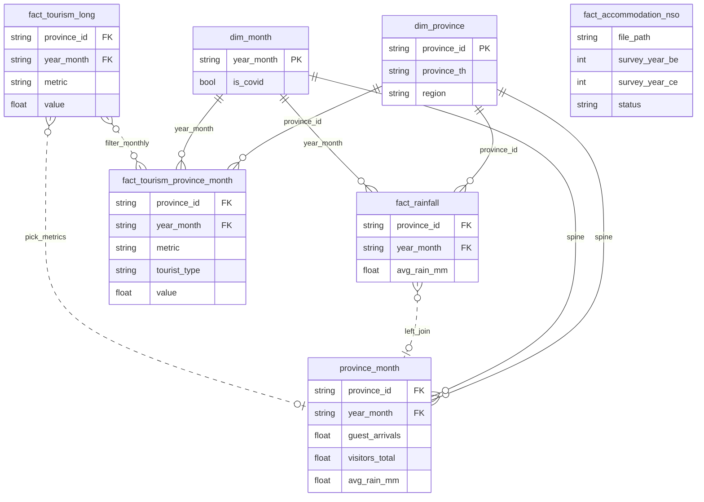
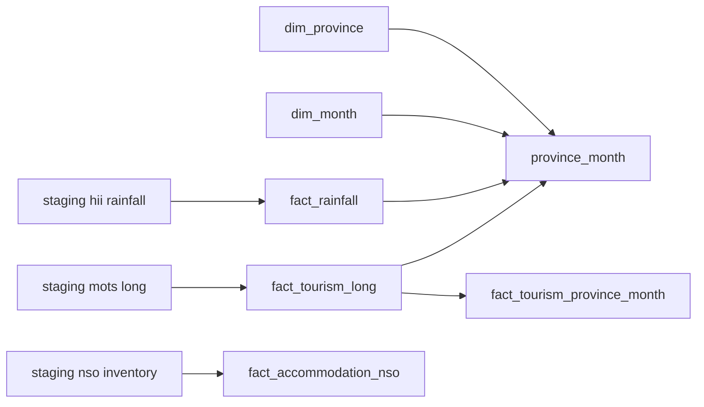

# Data dictionary

## Conventions

- **Dates** in core tables use Gregorian **CE** `year_month` (`YYYY-MM`) unless labeled `year_be` (Buddhist Era).
- **`is_covid`**: `true` for `2020-03` through `2022-12` inclusive (34 months); `false` otherwise. Stored in `dim_month` and joined to facts and `province_month`. Project-defined disruption window, not causation.

## Table relationships

Logical keys used in `build_core` (Parquet files do not enforce foreign keys). Solid lines are monthly province×month joins; dotted lines are derived or optional.

**Notes**

- `fact_tourism_long` also has **quarterly** and **sub_area** rows; many rows have no `year_month` — they do not join `dim_month` until pivoted to months elsewhere.
- `fact_accommodation_nso` is a **separate survey inventory**; this pipeline does **not** join it to `province_month`.
- `province_month` = `dim_province` × `dim_month` spine, plus rainfall and two tourism columns picked from the long table.

## Core tables (`data/core/`)

| Table | Grain | Description |
|-------|-------|-------------|
| `dim_province` | province_id | 77 Thai provinces (`province_th`, `province_en`, `region`) |
| `dim_month` | year_month | 2018-01 … 2025-08 with `year_be`, `is_covid` |
| `fact_rainfall` | province_id × year_month | HII min/max/avg rainfall (mm) |
| `fact_tourism_long` | row per metric | All parsed MOTS metrics (long format) |
| `fact_tourism_province_month` | province × month × metric × tourist_type | Province-month tourism only |
| `fact_accommodation_nso` | extracted workbook | NSO MD inventory (`survey_year_be`, `survey_year_ce`, `status`, `file_path`); not monthly |
| `province_month` | province × month | **Start here for DS/ML**: full 77×92 spine, `avg_rain_mm`, `guest_arrivals`, `visitors_total`, `is_covid` |

### `province_month` columns

| Column | Source | Notes |
|--------|--------|--------|
| `guest_arrivals` | MOTS domestic quarterly workbooks | Monthly guest nights / arrivals block (`Grand Total` row), 2018–2025 where published |
| `visitors_total` | MOTS monthly `(R)` sheets | Total visitors by province; typically 2023-01–2025-08 |
| `avg_rain_mm` | HII | Complete for all spine rows |

## Staging (`data/staging/`)

- `hii/fact_rainfall.parquet`
- `mots/fact_tourism_long.parquet`, `mots/quarantine/quarantine.csv`, `unmapped_provinces.csv`, `conflicts.csv`
- `nso/fact_accommodation_nso_inventory.parquet`

## Manifest

`data/manifest/manifest_downloads.csv` — provenance for every download (URL, sha256, status).
