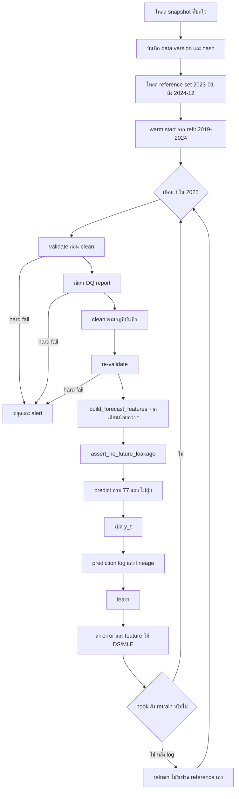

# แบบตัวป้อนสาย replay ปี 2025

สถานะ: **แบบที่ทีมอนุมัติแล้ว ยังไม่สร้างโค้ด** รอคำสั่งให้ลงมือสร้าง อย่า merge เข้า `main` ก่อนรีวิว

เอกสารนี้กำหนดตัวป้อนข้อมูล (data feeder) ที่เล่น `2025-01 .. 2025-12` ทีละเดือนให้โมเดลออนไลน์ ราวกับแต่ละเดือนเพิ่งมาถึง อ่านคู่กับ [กฎ feature](feature_rules_for_modeling.md) และ [HANDOFF_NEXT_STEPS.md](HANDOFF_NEXT_STEPS.md) การตัดสิน split และ warm start วันที่ 2026-11-20 อยู่ในเอกสารนั้นและใน `TIME_SPLIT` ของ `src/model/leakage.py`

ขอบเขตคือตัวป้อน: validate, data quality, clean, reference set, feature, log, และจุดส่งต่อ drift ให้ data scientist / ML engineer ไม่รวมอัลกอริทึมของโมเดล และไม่แก้ไปป์ไลน์ ingest / staging / core

## 1. วัตถุประสงค์

โมเดลที่ล็อกตัวเลข test ปี 2024 แล้ว ต้องถูกทดสอบต่อแบบ online บนปี 2025 โดยไม่เห็น `guest_arrivals_total` ของเดือน `t` ก่อน `predict`

ลำดับตายตัวต่อเดือนคือ **validate → data quality → clean → re-validate → feature → model** ห้ามข้ามขั้น หรือให้โมเดลเห็นแถวก่อน re-validate ผ่าน

ห้ามเทรนบนทั้งปี 2025 แล้วค่อยให้คะแนนย้อนหลัง สายนี้มี 12 เดือน สัญญาณ drift จึงสั้น นี่เป็นข้อแลกเปลี่ยนที่ยอมรับแล้ว เพราะปี 2024 ถูกใช้เป็น held-out test

## 2. อินพุต

| รายการ | ค่า |
|---|---|
| ไฟล์ | `data/model/province_month_unified.parquet` |
| Grain | 77 จังหวัด × เดือน, `province_id` สตริง 2 หลัก |
| ช่วงทั้งตาราง | 2018-01 .. 2025-12 (7,392 แถว) |
| ช่วงที่เล่น | `TIME_SPLIT["online_stream"]` = 2025-01 .. 2025-12 |
| Target | `guest_arrivals_total` |
| ฝน | `rain_avg_mm`, `rain_min_mm`, `rain_max_mm` |
| ธง | `is_covid` ตาม `covid_window` (2020-03 .. 2022-12) |

ประวัติก่อนปี 2025 ต้องอยู่ในแผงเดียวกัน เพราะ lag 12 ของปี 2025 อ่านปี 2024 และ `rain_roll3` อ่านสามเดือนก่อนหน้า อย่าตัดปี 2018–2024 ออกก่อนสร้าง feature

`visitors_total` ไม่มีในตารางนี้ และไม่ถูกส่งเข้าโมเดล ฝนของเดือน `t` ไม่เข้า feature ของ forecast จนกว่าทีมจะประกาศ nowcast

## 3. ลูปต่อเดือน

เรียงเดือนจาก `2025-01` ถึง `2025-12` ภายในเดือนเรียง `province_id` จากน้อยไปมาก ไม่สุ่มและไม่สุ่มตัวอย่าง (หัวข้อ 11)

สำหรับเดือน `t` ใช้เฉพาะแถวที่ `year_month <= t` แถวที่ `year_month > t` ถูกกันออกจากก้อนงานของเดือนนี้และบันทึกใน lineage ว่าถูกกันไว้ ไม่ใช่การลบออกจาก snapshot

1. **Validate** ก้อนก่อน clean (หัวข้อ 8) hard fail แล้วหยุด
2. **Data quality** เขียนรายงานรายเดือน (หัวข้อ 9) warn ไม่หยุด hard fail หยุด
3. **Clean** ตามกฎที่บันทึกทุกการเปลี่ยน (หัวข้อ 10) ไม่แก้ target เงียบ ๆ
4. **Re-validate** ก้อนที่ clean แล้วด้วยกฎเดียวกับหัวข้อ 8 ถ้ายังไม่ผ่านให้ hard fail ห้ามส่งต่อ
5. แยก `y_t` ออกจากเฟรม feature เรียก `build_forecast_features` แล้ว `assert_no_future_leakage` ทุกเดือนต้นทางต้อง `< t`
6. `predict` ครบ 77 จังหวัดก่อน จังหวัดหนึ่งห้าม `learn` จาก `y_t` ของเดือนเดียวกัน
7. เปิด `y_t` เขียน prediction log และ lineage (หัวข้อ 12)
8. `learn` ด้วย feature ชุดเดิมบวก `y_t`
9. ส่ง error และ feature ให้ drift hook ของ DS/MLE ถ้า hook สั่ง retrain ให้เกิดหลัง log ของเดือน `t` แล้วเท่านั้น และห้ามรีเฟรช reference set เอง



## 4. Warm start

การตัดสินของทีมวันที่ **2026-11-20** ลำดับนี้ตายตัว ไม่เหลือทางเลือกให้เลือกตอนสร้างสาย

1. ประเมินโมเดลที่เทรนบน **2019-01 .. 2022-12** โดย hyperparameter ถูกเลือกจาก validation **2023-01 .. 2023-12** กับ held-out test **2024-01 .. 2024-12**
2. บันทึกคะแนนปี 2024 เป็น baseline ที่แช่แข็ง: WAPE, MAE, RMSE, MASE ทั้งรวมและรายจังหวัด ไฟล์ที่กำหนดคือ `reports/baseline_test_2024.json` สคีมาอยู่ใน [docs/HANDOFF_NEXT_STEPS.md](HANDOFF_NEXT_STEPS.md)
3. Refit **configuration เดิม** บน **2019-01 .. 2024-12** ห้ามจูน hyperparameter เพิ่ม ไม่มีชุดข้อมูลเหลือไว้ตรวจการจูน
4. ใช้โมเดลที่ refit นั้นเป็น warm start ของสาย **2025-01 .. 2025-12**
5. เทียบ metric ของสาย 2025 กับ baseline ปี 2024

น้ำหนักที่ใช้รายงาน test ปี 2024 ต้องเป็นน้ำหนักที่ fit แค่ถึง 2022-12 ห้ามใช้โมเดลที่เห็นปี 2024 มาเขียน baseline ปี 2018 ไม่เข้า loss ใช้เป็น lag เท่านั้น ห้ามจูนบนปี 2024 หรือปี 2025

## 5. สัญญาที่โมเดลต้องเปิด

โมเดลเป็นอ็อบเจกต์ที่มีสองเมธอด สไตล์ `predict` แล้ว `learn` (`partial_fit` หรือ `learn_one` ได้ ถ้าชื่อในไลบรารีต่างออกไป ให้ห่อเป็นสองเมธอดนี้)

```text
predict(features) -> y_hat
learn(features, y_true) -> None
```

`features` หนึ่งแถวต่อจังหวัดของเดือน `t` คอลัมน์และชนิดข้อมูล:

| คอลัมน์ | dtype | บทบาท |
|---|---|---|
| `province_id` | string 2 หลัก (`"10"`, `"50"`) | คีย์ ห้ามเป็น int |
| `guest_lag_1` | float | `guest_arrivals_total` ของ `t-1` |
| `guest_lag_12` | float | ของ `t-12` สำหรับปี 2025 คือปี 2024 |
| `rain_lag_1` | float | `rain_avg_mm` ของ `t-1` |
| `rain_roll3` | float | ค่าเฉลี่ย `rain_avg_mm` ของ `t-3`, `t-2`, `t-1` |
| `is_covid` | bool | ธงปฏิทินของเดือน `t` ปี 2025 เป็นเท็จทั้งปี |
| `is_covid_lag12` | bool | ธงของ `t-12` ปี 2025 เป็นเท็จทั้งปี เพราะปี 2024 อยู่นอกโควิด คอลัมน์ยังต้องอยู่ |

`year_month` ไม่ใช่คอลัมน์ feature ในเฟรมนี้ ตัวป้อนรู้เดือน `t` อยู่แล้ว ห้ามมี `guest_arrivals_total`, `guest_arrivals_thai`, `guest_arrivals_foreign`, `visitors_total` หรือฝนของเดือน `t` ในเฟรมที่เข้า `predict`

`y_hat` และ `y_true` เป็น float ความยาว 77 เรียง `province_id` เดียวกับ `features` `learn` ได้รับ `features` ชุดเดียวกับที่เพิ่ง `predict` ไม่ใช่เฟรมที่ถูก shift ใหม่

ถ้าโมเดลใช้ตัวเลขสุ่ม ต้องรับ `seed` จากตัวป้อนตอนสร้างอ็อบเจกต์

## 6. สคีมา log

หนึ่งแถวต่อจังหวัดต่อเดือน เขียนทีละเดือนหลัง `predict` และก่อน `learn` ของเดือนถัดไป ไฟล์ที่เสนอ: `data/stream/replay_2025.parquet` (และ `.csv` แบบ UTF-8 with BOM ถ้าต้องเปิดใน Excel)

| คอลัมน์ | dtype | ความหมาย |
|---|---|---|
| `province_id` | string 2 หลัก | จังหวัด |
| `year_month` | string `YYYY-MM` | เดือนที่ทำนาย |
| `y_pred` | float | ค่าจาก `predict` |
| `y_true` | float | `guest_arrivals_total` ที่เปิดหลัง predict |
| `error` | float | `y_true - y_pred` |
| `abs_error` | float | ค่าสัมบูรณ์ของ error |
| `model_version` | string | รุ่นที่ใช้ predict เดือนนี้ |
| `drift_flag` | bool | hook ของเดือนนี้ยกธงหรือไม่ |
| `drift_detector` | string หรือ null | ชื่อตัวตรวจ ถ้ายกธง |
| `retrain_triggered` | bool | มี retrain หลัง log เดือนนี้หรือไม่ |
| `seed` | int | seed ของรอบนี้ |
| `split_role` | string | คงที่ `online_stream` |
| `replay_index` | int | ลำดับเดือนในสาย 1 .. 12 |

`logged_at` แบบนาฬิกาเครื่องเขียนได้ในคอลัมน์แยก แต่ห้ามเข้าโมเดลและห้ามใช้เรียงผล การเรียงใช้ `year_month` แล้ว `province_id` เท่านั้น เพื่อให้รันซ้ำได้ผลเดิม

## 7. Metrics

ตัวหลักคือ **WAPE** = `sum(|y − ŷ|) / sum(|y|)` รายงานทั้งก้อนและรายจังหวัด ตาม audit รายการ 11 กรุงเทพฯ (`province_id` `10`) เป็นประมาณ 19.5% ของปริมาณทั้งประเทศ คะแนนที่พูลอย่างเดียวถูกกรุงเทพฯ ครอบ

รายงานคู่กัน: MAE, RMSE, MASE เทียบ seasonal naive `ŷ_t = guest_lag_12` ในปี 2025 lag 12 มีครบทุกจังหวัดเพราะปี 2024 อยู่ในตาราง

นอกจากคะแนนสะสมทั้ง 12 เดือน ให้มี WAPE แบบหน้าต่างเลื่อน 3 เดือน (จบที่เดือนปัจจุบัน) เพื่อดู drift ระหว่างปี สายสั้น หน้าต่างเลื่อนจึงมีได้ไม่กี่จุด นี่คือข้อจำกัดที่ต้องเขียนในรายงาน ไม่ใช่เหตุให้ขยายสายกลับไปรวมปี 2024

**MAPE ไม่ใช่ตัวหลัก** แถว `guest_arrivals_total = 0` ทำให้หารด้วยศูนย์ แถวศูนย์ 27 แถวที่รู้แล้วอยู่ใน 2020-04, 2020-05, 2021-01 ไม่ได้อยู่ในปี 2025 แต่กฎทั้งโปรเจกต์ยังไม่ใช้ MAPE เป็นตัวเทียบระหว่าง validation, test และ stream

## 8. Validate

รันสองครั้ง: ก่อน clean และหลัง clean ชุดกฎเดียวกัน ขั้นแรกจับ schema ที่พัง ขั้นหลังยืนยันว่า clean ไม่ได้ทำให้สัญญายังเสียอยู่

คอลัมน์ที่ต้องมีในก้อนเดือน `t`: `province_id`, `year_month`, `guest_arrivals_total`, `guest_arrivals_thai`, `guest_arrivals_foreign`, `rain_avg_mm`, `rain_min_mm`, `rain_max_mm`, `is_covid`

| การตรวจ | เกณฑ์ | เมื่อไม่ผ่าน |
|---|---|---|
| ชื่อคอลัมน์ | ครบชุดด้านบน ไม่มีชื่อแปลกที่โมเดลจะอ่านเป็น target | **hard fail** |
| `province_id` | ก่อน clean ยอมรับเลข 1–2 หลักที่ pad ได้ หลัง clean ต้องเป็นสตริง `\d{2}` | **hard fail** ถ้า pad ไม่ได้หรือยังไม่เป็น `\d{2}` หลัง clean |
| `year_month` | สตริง `YYYY-MM` เดือน 01–12 | **hard fail** |
| จำนวนแถว | 77 แถวของเดือน `t` | **hard fail** |
| คีย์ | `province_id` + `year_month` ไม่ซ้ำหลัง dedupe | **hard fail** ถ้าค่าขัดกัน หรือยังซ้ำหลัง clean |
| อนาคต | ก้อนงานของเดือน `t` ไม่มี `year_month > t` | **hard fail** ถ้าหลุดเข้า feature หรือเข้าเฟรม predict |
| ช่วงค่า | `guest_arrivals_total >= 0` และฝนทั้งสามคอลัมน์ `>= 0` | **hard fail** ห้าม clip |
| ลำดับฝน | `rain_min_mm <= rain_avg_mm <= rain_max_mm` | **hard fail** |
| null | ไม่มี null ใน target และฝนทั้งสามคอลัมน์หลัง clean | **hard fail** |
| `is_covid` | ตรง `calendar.is_covid` ของเดือนนั้น (2020-03 .. 2022-12) | **hard fail** ห้ามเขียนทับให้ตรงเงียบ ๆ |

`is_covid_lag12` ของ feature ปี 2025 ต้องเป็นเท็จ เพราะ `t-12` อยู่ในปี 2024 ถ้าไม่เป็นเท็จให้ hard fail หลังสร้าง feature เช่นกัน feature ที่เข้า `predict` ต้องไม่มี null ใน `guest_lag_1`, `guest_lag_12`, `rain_lag_1`, `rain_roll3`

Hard fail หมายถึงหยุดโปรเซส exit code ไม่เป็นศูนย์ ไม่ `predict` ไม่ `learn` ไม่เติมค่า และเขียน lineage ว่าขั้นไหนล้ม Warn อยู่ในรายงาน DQ เท่านั้น ไม่หยุดสาย

ตอนโหลด snapshot ครั้งแรก ตรวจว่าทั้งไฟล์มี 7,392 แถว ช่วง 2018-01 .. 2025-12 และไม่มีคีย์ซ้ำก่อนเริ่มเดือนแรก

## 9. Data quality

ขั้นนี้อยู่ระหว่าง validate รอบแรกกับ clean เขียนไฟล์ทุกเดือนแม้จะมีแค่ warn ถ้ามี hard fail จากหัวข้อ 8 ให้เขียนรายงานแล้วหยุด

ไฟล์: `reports/stream_dq/{year_month}.json` และแถวธง `reports/stream_dq/{year_month}_rows.parquet`

| การตรวจ | วิธี | severity |
|---|---|---|
| ความครบ | มีครบ 77 จังหวัด และมีเดือนประวัติที่ lag ต้องใช้ (`t-1`, `t-3`, `t-12`) | hard fail ถ้าขาด |
| ความสด | snapshot ที่ปักไว้มีเดือน `t` อยู่แล้ว | hard fail ถ้าเดือน `t` ยังไม่มีใน snapshot (ดูหัวข้อ 12) |
| outlier รายจังหวัด | robust z ของ `guest_arrivals_total` เทียบประวัติจังหวัดนั้นถึง `t-1` เท่านั้น: `(x - median) / (1.4826 * MAD)` ถ้า MAD เป็น 0 ให้ข้าม z | **warn** ถ้า \|z\| > 3.5 ไม่ทิ้งแถว |
| MoM | `\|y_t - y_{t-1}\| / y_{t-1}` เมื่อ `y_{t-1} > 0` | **warn** ถ้ามากกว่า 1.0 ไม่ทิ้งแถว |
| แถวศูนย์ | `guest_arrivals_total = 0` | **warn** เก็บค่าไว้ เป็นยอดจริงได้ แถวศูนย์ 27 แถวที่รู้แล้วอยู่ใน 2020-04, 2020-05, 2021-01 |
| คีย์ซ้ำ | แถวซ้ำทั้งแถว หรือซ้ำคีย์แต่ค่าต่าง | exact duplicate ส่งต่อให้ clean ส่วนค่าขัดกันเป็น hard fail |
| thai + foreign | เมื่อทั้งคู่ไม่เป็น null ถ้า \|total − (thai + foreign)\| > max(1, 0.001 × \|total\|) | **warn** ปี 2018 ทั้งคู่เป็น null โดยตั้งใจ ไม่นับเป็นผิด และห้ามแก้ total |

สคีมา JSON:

```json
{
  "year_month": "2025-01",
  "data_version": "sha256:...",
  "n_rows": 77,
  "hard_fail": false,
  "checks": [
    {"name": "row_count", "severity": "hard", "passed": true, "detail": "77"}
  ]
}
```

Parquet ของธงมี `province_id` (สตริง 2 หลัก), `year_month`, `check`, `severity`, `value`, `detail` เปรียบเทียบ outlier ใช้เฉพาะเดือน `< t` จึงไม่นำเดือนที่กำลังทำนายของจังหวัดอื่นในอนาคตเข้ามา

## 10. Clean

กฎ deterministic รันหลัง DQ และก่อน re-validate ทุกการเปลี่ยนลง lineage การเปลี่ยนที่ทำให้ค่า target ไม่เท่าเดิมแบบเงียบ ๆ ห้ามทำ

| กฎ | ทำอะไร | บันทึก |
|---|---|---|
| cast ชนิด | นับคนและฝนเป็น float, `year_month` เป็นสตริง, `is_covid` เป็น bool | `cast` ถ้าค่าตัวเลขไม่คงเดิมให้ hard fail |
| `province_id` | ตัดช่องว่าง ถ้าเป็นเลข 1–2 หลักให้เติมศูนย์เป็น `\d{2}` | `pad_province_id` เมื่อสตริงเปลี่ยน |
| dedupe | แถวที่ซ้ำทุกคอลัมน์ เก็บแถวเดียว | `dedupe_exact` |
| คีย์เดียวกันแต่ค่าต่าง | ไม่เลือกแถว ไม่เฉลี่ย | hard fail |
| ฝนขาด | ไม่ carry forward ไม่เติม 0 ไม่ใช้ค่าจังหวัดข้างเคียง ถ้า unified เป็น null ให้คัดลอกเดือนเดียวกันจาก `data/staging/hii/fact_rainfall.parquet` เมื่อมีครบสามคอลัมน์ | `rain_from_staging_exact_month` ถ้า staging ก็ไม่มีให้ hard fail |
| ค่าติดลบ | ไม่ clip | hard fail |
| target | `guest_arrivals_total` / `_thai` / `_foreign` เปลี่ยนได้แค่ cast ที่ค่าเท่าเดิม | ห้ามแก้เป็นอย่างอื่น |

`is_covid` ที่ไม่ตรงปฏิทินไม่ถูกเขียนทับในขั้น clean ให้ไปตายที่ re-validate

## 11. ไม่มีการสุ่มตัวอย่าง

สายนี้ใช้ครบ 77 แถวทุกเดือน ไม่ sample ไม่ bootstrap ไม่ถ่วงด้วยการดึงแกรงเทพฯ ออก เหตุผลคือ 77 จังหวัดคือประชากรทั้งชุดของ grain นี้ ไม่ใช่ตัวอย่างจากประชากรที่ใหญ่กว่า การตัดจังหวัดจะทำให้ WAPE ของสาย 2025 เทียบกับ baseline ปี 2024 ไม่ได้ และกรุงเทพฯ ประมาณ 19.5% ของปริมาณจะหายหรือถูกขยายโดยไม่ตั้งใจ

ลำดับคงที่คือ `year_month` แล้ว `province_id` จากน้อยไปมาก ห้าม shuffle

## 12. Snapshot เดือนที่มาสาย และ lineage

MOTS อาจแก้เดือนเก่าในไฟล์รุ่นหลัง สาย replay หนึ่งรอบผูกกับ snapshot เดียวของตาราง unified ที่คัดลอกไว้ เช่น `data/stream/snapshots/unified_{sha256}.parquet` ระหว่างรอบห้ามสลับไปอ่านไฟล์ที่ถูก rebuild ทับ ถ้าต้องรับตัวเลขที่ MOTS แก้ ให้เริ่มรอบใหม่ด้วย snapshot ใหม่และ `data_version` ใหม่ ห้ามปน hash ในรอบเดียว

เดือน `t` ที่ไม่มีใน snapshot: **halt และ alert** ห้ามข้ามเดือน เพราะ lag 1 ของเดือนถัดไปจะขาด ห้าม impute ทั้ง target และฝน

Lineage หนึ่งไฟล์ต่อเดือน `data/stream/lineage/{year_month}.json`:

| ฟิลด์ | ความหมาย |
|---|---|
| `data_version` | sha256 ของ snapshot ทั้งไฟล์ |
| `input_hash` | sha256 ของก้อน `year_month <= t` ก่อน clean |
| `checks` | รายการผ่านหรือล้ม พร้อม severity |
| `cleaning_actions` | รายการกฎที่เกิดจริง รวมจำนวนแถว |
| `feature_table_hash` | sha256 ของเฟรมที่เข้า `predict` |
| `model_version` | รุ่นที่ predict เดือนนี้ |
| `reference_version` | รุ่นของ reference set |
| `dq_report` | พาธของรายงาน DQ |

นาฬิกาเครื่องเขียนได้เป็น `logged_at` แต่ไม่เข้า hash และไม่เข้าโมเดล

## 13. Reference set

ความรับผิดชอบของ data engineer ใช้เทียบ feature drift ไม่ใช้เป็นแถวเทรนของสาย

หน้าต่างคือ **2023-01 .. 2024-12** (24 เดือน × 77 = 1,848 แถว) เป็นช่วงหลังโควิดเดียวกับที่โมเดลถูก validate และ test **ไม่รวม** COVID 2020-03 .. 2022-12 และไม่ใช้ปี 2018–2022 เป็นฐาน เพราะระดับผู้เข้าพักช่วงนั้นต่ำกว่าหลังฟื้นตัว ตัวตรวจจะติดตลอด

ไฟล์:

- `data/model/reference_2023_2024.parquet` แถวจริงของช่วงนี้ พร้อมคอลัมน์ feature ที่ `build_forecast_features` สร้างได้จากประวัติก่อนแต่ละเดือน (`guest_lag_1`, `guest_lag_12`, `rain_lag_1`, `rain_roll3`, `rain_avg_mm`, `guest_arrivals_total`, `province_id`, `year_month`)
- `data/model/reference_2023_2024_stats.json` มี `version` (ค่าเริ่ม `2023-2024-v1`), `window`, `n_rows` = 1848, `source_hash`, `excludes_covid_window: true` และสถิติรายจังหวัดต่อคอลัมน์ (median, MAD, quantiles) สำหรับ PSI / KS

รีเฟรชได้เฉพาะเมื่อทีมตัดสินใจ เช่นหลังยืนยัน retrain แล้วให้ตัดชุดใหม่และขึ้น version alarm จาก drift hook **ไม่**เขียนไฟล์นี้ทับเอง

## 14. Drift ส่งต่อให้ DS / ML engineer

Data engineer ส่งของและจุดเกี่ยว ไม่เลือกตัวตรวจและไม่ตั้ง threshold

ของที่ DE ส่งทุกเดือนหลัง `predict`:

- แถว error ใน prediction log (`y_true`, `y_pred`, `error`) ครบ 77 จังหวัด
- เฟรม feature ที่เข้า `predict` (`rain_lag_1`, `rain_roll3`, `guest_lag_1`, `guest_lag_12`)
- reference set และ stats ตามหัวข้อ 13
- อินเทอร์เฟซที่ DS ทำให้ครบ: `update_errors(errors) -> alarm` และ `update_features(features) -> alarm`

DS / MLE เป็นเจ้าของตัวเลือกและเกณฑ์ ตัวเลือกที่แบบนี้รองรับ:

| กลุ่ม | ตัวเลือก | สิ่งที่ดู |
|---|---|---|
| error | ADWIN | ค่าเฉลี่ย error เปลี่ยนหน้าต่าง |
| error | Page-Hinkley | error สะสมเกินเกณฑ์ |
| error | DDM | อัตรา error เปลี่ยนแบบ Drift Detection Method |
| input | PSI | การกระจายของฝนและ lag เทียบ reference |
| input | KS | การกระจายเดียวกันแบบสองตัวอย่าง |

Retrain ยังเป็นทางเลือกของทีม: refit ถึงเดือน `t` หลังเปิด `y_t` แล้ว, หรือ `partial_fit` ต่อ, หรือบันทึกธงอย่างเดียว ทุกทางเกิดหลัง lineage ของเดือนนั้น `model_version` ของเดือนถัดไปจึงเปลี่ยนได้ สายมี 12 จุด ตัวตรวจที่ไวเกินจะติดฤดูเดียว รายงานต้องโชว์จำนวนครั้งที่เตือน

## 15. ความคงที่ของการรันซ้ำ

รันซ้ำด้วย snapshot เดิม seed เดิม reference version เดิม และ `model_version` เริ่มต้นเดิม ต้องได้ `y_pred`, error, รายงาน DQ และ lineage เดิม

- เรียง `year_month` แล้ว `province_id` อย่าพึ่งลำดับแถวใน parquet
- seed เริ่มต้น `2025` ส่งเข้าโมเดลถ้าโมเดลสุ่ม
- นาฬิกาเครื่องไม่อยู่ใน `predict`, `learn` หรือ hash
- ไม่มี `--run-id` ให้เขียนทับ log เดิม ถ้ามี `--run-id` ให้คนละไฟล์ แต่ตัวเลขทำนายต้องตรงกันเมื่อ seed ตรงกัน
- retrain ถ้าเปิดใช้ อ่านประวัติถึง `t` ตามลำดับเดิม ไม่สุ่มแถว

โมเดลที่สุ่มโดยไม่รับ seed ใช้ในสายนี้ไม่ได้

## 16. การรันบน Windows

ยังไม่มียูนิตรัน คำสั่งที่เสนอ รันจาก root ของ repo ใน PowerShell โมดูลต่อ path ด้วย `pathlib` อาร์กิวเมนต์ในตัวอย่างใช้ `/` ซึ่ง Python บน Windows รับได้

```powershell
python -m src.stream.replay --start 2025-01 --end 2025-12 --seed 2025 --model-path models/warm_start.joblib --log data/stream/replay_2025.parquet --snapshot data/stream/snapshots/unified_PINNED.parquet --reference data/model/reference_2023_2024.parquet
```

`--start` และ `--end` ต้องเท่ากับ `TIME_SPLIT["online_stream"]` ถ้าส่งช่วงอื่นให้ปฏิเสธ `--model-path` คือไฟล์ refit 2019-01 .. 2024-12 ในหัวข้อ 4 Python 3.11 ขึ้นไป ตาม README

## 17. โครงไฟล์ที่เสนอ

ยังไม่สร้างไฟล์เหล่านี้

| พาธ | หน้าที่ |
|---|---|
| `src/stream/replay.py` | ลูปและ CLI |
| `src/stream/contracts.py` | validate / re-validate |
| `src/stream/quality.py` | DQ และรายงาน |
| `src/stream/clean.py` | กฎ clean |
| `src/stream/reference.py` | สร้างและโหลด reference set |
| `src/stream/lineage.py` | hash และ audit รายเดือน |
| `src/stream/metrics.py` | WAPE, MAE, RMSE, MASE |
| `src/stream/drift.py` | จุดเกี่ยวที่ DS ทำให้ครบ ไม่เลือกตัวตรวจ |
| `tests/test_stream_replay.py` | เทสตามหัวข้อ 18 |
| `reports/stream_dq/` | รายงาน DQ |
| `data/stream/lineage/` | audit รายเดือน |
| `data/stream/snapshots/` | snapshot ที่ปัก hash |
| `data/model/reference_2023_2024.parquet` | reference set |
| `data/model/reference_2023_2024_stats.json` | สถิติและ version |

เรียก `build_forecast_features` และ `assert_no_future_leakage` จาก `src/model/leakage.py` ห้ามคัดลอกสูตร lag

## 18. แผนเทส

เทสเหล่านี้ยังไม่ถูกเขียน จนกว่าจะมีโมดูล ใช้เฟรมเล็กได้ ไม่ต้องมีโมเดลจริง

- validate เป็น hard fail เมื่อคอลัมน์หาย, `year_month` ผิดรูปแบบ, ไม่ครบ 77 แถว, มี `year_month > t` ในก้อนงาน, target หรือฝนติดลบ, `rain_min > rain_avg`, target หรือฝนเป็น null หลัง clean, `is_covid` ไม่ตรงปฏิทิน
- robust z และแถวศูนย์เป็น warn แถวไม่ถูกลบ และสายไม่หยุด
- clean เติม `province_id` เป็นสองหลักแล้วบันทึก action ค่า `guest_arrivals_total` เท่าเดิม
- คีย์ซ้ำที่ค่าต่างกันเป็น hard fail แถวที่ซ้ำทุกคอลัมน์เหลือหนึ่งแถว
- ฝน null ถูกเติมจาก staging เฉพาะเดือนเดียวกัน ถ้า staging ไม่มีให้หยุด และไม่มีการ carry forward
- เดือน `t` หายจาก snapshot แล้วหยุด ไม่ skip ไม่ impute
- เอาต์พุตทุกเดือนมี 77 แถวเรียง `province_id` ไม่มีการสุ่มตัวอย่าง
- reference set คือ 2023-01 .. 2024-12 จำนวน 1,848 แถว และไม่มีเดือนในช่วง 2020-03 .. 2022-12
- lineage มี `input_hash`, ผลตรวจ, cleaning actions, `feature_table_hash`, `model_version`
- เฟรมของ `2025-03` ไม่มีค่าจากเดือนนั้นหรือเดือนถัดไป และ `assert_no_future_leakage` ผ่าน
- `predict` ครบ 77 แถวก่อน `learn` และเฟรมไม่มี `guest_arrivals_total`
- lag 12 ของ `2025-01` คือ `2024-01` และ `is_covid_lag12` เป็นเท็จ
- รันสองครั้งด้วย snapshot และ seed เดิมได้ `y_pred` ตรงกัน
- `--start` / `--end` ที่ไม่ใช่ 2025-01 .. 2025-12 ถูกปฏิเสธ
- WAPE ตรงสูตร และรายงานไม่มี MAPE เป็นตัวหลัก

## 19. คำถามที่ยังเปิด

ตัดสินแล้วและไม่อยู่ในรายการนี้: warm start (หัวข้อ 4), ไม่สุ่มตัวอย่าง (หัวข้อ 11), เดือนหายให้ halt (หัวข้อ 12), หน้าต่าง reference (หัวข้อ 13), hard fail กับ warn (หัวข้อ 8–9)

1. DS / MLE เลือก ADWIN, Page-Hinkley, DDM, PSI, KS และ threshold เอง DE ไม่เลือกให้
2. Retrain ระหว่างสายเป็น refit ทั้งก้อน, `partial_fit` หรือบันทึกธงอย่างเดียว
3. พาธไฟล์โมเดลและเจ้าของสตริง `model_version`
4. ฝนเดือนเดียวกันยังเป็น nowcast ที่ยังไม่ตัดสิน สายนี้สมมติว่าเป็น forecast
5. ต้องเขียน prediction log เป็น CSV สำหรับ Excel นอกจาก parquet หรือไม่
