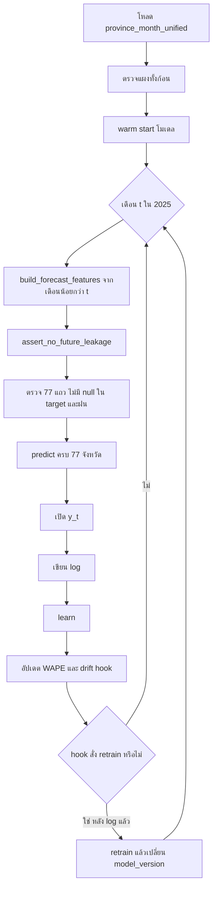

# แบบตัวป้อนสาย replay ปี 2025

สถานะ: **แบบ (design) เท่านั้น ยังไม่สร้างโค้ด** ทีมจะรีวิวเอกสารนี้ก่อน แล้วค่อยสั่งให้ลงมือสร้าง

เอกสารนี้กำหนดตัวป้อนข้อมูล (data feeder) ที่เล่น `2025-01 .. 2025-12` ทีละเดือนให้โมเดลออนไลน์ ราวกับแต่ละเดือนเพิ่งมาถึง อ่านคู่กับ [กฎ feature](feature_rules_for_modeling.md) การตัดสิน split วันที่ 2026-11-20 อยู่ในเอกสารนั้นและใน `TIME_SPLIT` ของ `src/model/leakage.py`

ขอบเขตของแบบนี้คือตัวป้อน การตรวจสัญญา บันทึกผล และจุดเกี่ยว drift ไม่รวมอัลกอริทึมของโมเดล และไม่แก้ไปป์ไลน์ ingest / staging / core

## 1. วัตถุประสงค์

โมเดลที่ล็อกตัวเลข test ปี 2024 แล้ว ต้องถูกทดสอบต่อแบบ online บนปี 2025 โดยไม่เห็น `guest_arrivals_total` ของเดือน `t` ก่อน `predict`

ตัวป้อนทำสี่อย่างต่อเดือน:

1. สร้าง feature จากข้อมูลถึง `t-1` เท่านั้น
2. ให้โมเดล `predict` ทั้ง 77 จังหวัด
3. เปิดค่าจริง `y_t` หลัง predict ครบ
4. ให้โมเดล `learn` แล้วเขียน log

ห้ามเทรนบนทั้งปี 2025 แล้วค่อยให้คะแนนย้อนหลัง สายนี้มี 12 เดือน สัญญาณ drift จึงสั้น นี่เป็นข้อแลกเปลี่ยนที่ยอมรับแล้ว เพราะปี 2024 ถูกใช้เป็น held-out test

## 2. อินพุต

| รายการ | ค่า |
|---|---|
| ไฟล์ | `data/model/province_month_unified.parquet` |
| Grain | 77 จังหวัด × เดือน, `province_id` สตริง 2 หลัก |
| ช่วงทั้งตาราง | 2018-01 .. 2025-12 (7,392 แถว) |
| ช่วงที่เล่น | `TIME_SPLIT["online_stream"]` = 2025-01 .. 2025-12 |
| Target | `guest_arrivals_total` |
| ฝน | `rain_avg_mm`, `rain_min_mm`, `rain_max_mm` |
| ธง | `is_covid` ตาม `covid_window` (2020-03 .. 2022-12) |

ประวัติก่อนปี 2025 ต้องอยู่ในแผงเดียวกัน เพราะ lag 12 ของปี 2025 อ่านปี 2024 และ `rain_roll3` อ่านสามเดือนก่อนหน้า อย่าตัดปี 2018–2024 ออกก่อนสร้าง feature

`visitors_total` ไม่มีในตารางนี้ และไม่ถูกส่งเข้าโมเดล ฝนของเดือน `t` ไม่เข้า feature ของ forecast จนกว่าทีมจะประกาศ nowcast

## 3. ลูปต่อเดือน

เรียงเดือนจาก `2025-01` ถึง `2025-12` ภายในเดือนเรียง `province_id` จากน้อยไปมาก

สำหรับเดือน `t`:

1. ตัดแผงที่ใช้สร้าง feature ให้เหลือ `year_month <= t` ค่า `y_t` ถูกแยกไว้ต่างหาก ไม่ใส่ในเฟรมที่ส่งเข้า `predict`
2. เรียก `build_forecast_features(panel, t)` แล้ว `assert_no_future_leakage` กับเดือนที่ฟังก์ชันนั้นอ่าน ทุกเดือนต้อง `< t`
3. ตรวจสัญญาก่อนส่ง (หัวข้อ 9) ไม่ผ่านให้หยุดเดือนนั้น ไม่ predict และไม่ learn
4. `predict` ครบ 77 จังหวัดก่อน จังหวัดหนึ่งห้าม `learn` จาก `y_t` ของตัวเองหรือของจังหวัดอื่นในเดือนเดียวกัน
5. เปิด `y_t` คำนวณ error เขียน log
6. `learn` ด้วย feature ชุดเดิมบวก `y_t`
7. อัปเดต metric สะสม และส่ง error เข้า drift hook ถ้า hook สั่ง retrain ให้เกิดหลัง log ของเดือน `t` แล้วเท่านั้น



## 4. Warm start

การตัดสินของทีมวันที่ **2026-11-20** ลำดับนี้ตายตัว ไม่เหลือทางเลือกให้เลือกตอนสร้างสาย

1. ประเมินโมเดลที่เทรนบน **2019-01 .. 2022-12** โดย hyperparameter ถูกเลือกจาก validation **2023-01 .. 2023-12** กับ held-out test **2024-01 .. 2024-12**
2. บันทึกคะแนนปี 2024 เป็น baseline ที่แช่แข็ง: WAPE, MAE, RMSE, MASE ทั้งรวมและรายจังหวัด ไฟล์ที่กำหนดคือ `reports/baseline_test_2024.json` สคีมาอยู่ใน [docs/HANDOFF_NEXT_STEPS.md](HANDOFF_NEXT_STEPS.md)
3. Refit **configuration เดิม** บน **2019-01 .. 2024-12** ห้ามจูน hyperparameter เพิ่ม ไม่มีชุดข้อมูลเหลือไว้ตรวจการจูน
4. ใช้โมเดลที่ refit นั้นเป็น warm start ของสาย **2025-01 .. 2025-12**
5. เทียบ metric ของสาย 2025 กับ baseline ปี 2024

น้ำหนักที่ใช้รายงาน test ปี 2024 ต้องเป็นน้ำหนักที่ fit แค่ถึง 2022-12 ห้ามใช้โมเดลที่เห็นปี 2024 มาเขียน baseline ปี 2018 ไม่เข้า loss ใช้เป็น lag เท่านั้น ห้ามจูนบนปี 2024 หรือปี 2025

## 5. สัญญาที่โมเดลต้องเปิด

โมเดลเป็นอ็อบเจกต์ที่มีสองเมธอด สไตล์ `predict` แล้ว `learn` (`partial_fit` หรือ `learn_one` ได้ ถ้าชื่อในไลบรารีต่างออกไป ให้ห่อเป็นสองเมธอดนี้)

```text
predict(features) -> y_hat
learn(features, y_true) -> None
```

`features` หนึ่งแถวต่อจังหวัดของเดือน `t` คอลัมน์และชนิดข้อมูล:

| คอลัมน์ | dtype | บทบาท |
|---|---|---|
| `province_id` | string 2 หลัก (`"10"`, `"50"`) | คีย์ ห้ามเป็น int |
| `guest_lag_1` | float | `guest_arrivals_total` ของ `t-1` |
| `guest_lag_12` | float | ของ `t-12` สำหรับปี 2025 คือปี 2024 |
| `rain_lag_1` | float | `rain_avg_mm` ของ `t-1` |
| `rain_roll3` | float | ค่าเฉลี่ย `rain_avg_mm` ของ `t-3`, `t-2`, `t-1` |
| `is_covid` | bool | ธงปฏิทินของเดือน `t` ปี 2025 เป็นเท็จทั้งปี |
| `is_covid_lag12` | bool | ธงของ `t-12` ปี 2025 เป็นเท็จทั้งปี เพราะปี 2024 อยู่นอกโควิด คอลัมน์ยังต้องอยู่ |

`year_month` ไม่ใช่คอลัมน์ feature ในเฟรมนี้ ตัวป้อนรู้เดือน `t` อยู่แล้ว ห้ามมี `guest_arrivals_total`, `guest_arrivals_thai`, `guest_arrivals_foreign`, `visitors_total` หรือฝนของเดือน `t` ในเฟรมที่เข้า `predict`

`y_hat` และ `y_true` เป็น float ความยาว 77 เรียง `province_id` เดียวกับ `features` `learn` ได้รับ `features` ชุดเดียวกับที่เพิ่ง `predict` ไม่ใช่เฟรมที่ถูก shift ใหม่

ถ้าโมเดลใช้ตัวเลขสุ่ม ต้องรับ `seed` จากตัวป้อนตอนสร้างอ็อบเจกต์

## 6. สคีมา log

หนึ่งแถวต่อจังหวัดต่อเดือน เขียนทีละเดือนหลัง `predict` และก่อน `learn` ของเดือนถัดไป ไฟล์ที่เสนอ: `data/stream/replay_2025.parquet` (และ `.csv` แบบ UTF-8 with BOM ถ้าต้องเปิดใน Excel)

| คอลัมน์ | dtype | ความหมาย |
|---|---|---|
| `province_id` | string 2 หลัก | จังหวัด |
| `year_month` | string `YYYY-MM` | เดือนที่ทำนาย |
| `y_pred` | float | ค่าจาก `predict` |
| `y_true` | float | `guest_arrivals_total` ที่เปิดหลัง predict |
| `error` | float | `y_true - y_pred` |
| `abs_error` | float | ค่าสัมบูรณ์ของ error |
| `model_version` | string | รุ่นที่ใช้ predict เดือนนี้ |
| `drift_flag` | bool | hook ของเดือนนี้ยกธงหรือไม่ |
| `drift_detector` | string หรือ null | ชื่อตัวตรวจ ถ้ายกธง |
| `retrain_triggered` | bool | มี retrain หลัง log เดือนนี้หรือไม่ |
| `seed` | int | seed ของรอบนี้ |
| `split_role` | string | คงที่ `online_stream` |
| `replay_index` | int | ลำดับเดือนในสาย 1 .. 12 |

`logged_at` แบบนาฬิกาเครื่องเขียนได้ในคอลัมน์แยก แต่ห้ามเข้าโมเดลและห้ามใช้เรียงผล การเรียงใช้ `year_month` แล้ว `province_id` เท่านั้น เพื่อให้รันซ้ำได้ผลเดิม

## 7. Metrics

ตัวหลักคือ **WAPE** = `sum(|y − ŷ|) / sum(|y|)` รายงานทั้งก้อนและรายจังหวัด ตาม audit รายการ 11 กรุงเทพฯ (`province_id` `10`) เป็นประมาณ 19.5% ของปริมาณทั้งประเทศ คะแนนที่พูลอย่างเดียวถูกกรุงเทพฯ ครอบ

รายงานคู่กัน: MAE, RMSE, MASE เทียบ seasonal naive `ŷ_t = guest_lag_12` ในปี 2025 lag 12 มีครบทุกจังหวัดเพราะปี 2024 อยู่ในตาราง

นอกจากคะแนนสะสมทั้ง 12 เดือน ให้มี WAPE แบบหน้าต่างเลื่อน 3 เดือน (จบที่เดือนปัจจุบัน) เพื่อดู drift ระหว่างปี สายสั้น หน้าต่างเลื่อนจึงมีได้ไม่กี่จุด นี่คือข้อจำกัดที่ต้องเขียนในรายงาน ไม่ใช่เหตุให้ขยายสายกลับไปรวมปี 2024

**MAPE ไม่ใช่ตัวหลัก** แถว `guest_arrivals_total = 0` ทำให้หารด้วยศูนย์ แถวศูนย์ 27 แถวที่รู้แล้วอยู่ใน 2020-04, 2020-05, 2021-01 ไม่ได้อยู่ในปี 2025 แต่กฎทั้งโปรเจกต์ยังไม่ใช้ MAPE เป็นตัวเทียบระหว่าง validation, test และ stream

## 8. จุดเกี่ยว drift

ตัวป้อนไม่ฝังอัลกอริทึมเดียว ให้มีอินเทอร์เฟซ `update(errors) -> alarm` ทางเลือกที่เสนอ มีสองแบบ ยังไม่เลือก:

| ตัวเลือก | สิ่งที่ดู | เมื่อไหร่ถือว่าเตือน |
|---|---|---|
| ADWIN | error รายจังหวัด หรือ WAPE รายเดือน | หน้าต่างตรวจพบค่าเฉลี่ย error เปลี่ยน |
| Page-Hinkley | error สะสม | ค่าสะสมเกินเกณฑ์ที่ตั้งตอน warm start |

สิ่งที่กระตุ้น retrain เป็นทางเลือกเช่นกัน:

- เตือนครั้งเดียวแล้ว refit บนประวัติถึงเดือน `t` (หลัง `y_t` ถูกเปิดแล้ว) ด้วยชุดเดียวกับ warm start
- เตือนแล้วสลับไป `partial_fit` ต่อ โดยไม่ refit ทั้งก้อน
- บันทึกธงอย่างเดียว ยังไม่ retrain จนกว่าทีมจะกำหนดเกณฑ์

ทุกทางต้องเกิดหลัง log ของเดือนนั้น `model_version` ของเดือนถัดไปจึงเปลี่ยนได้ เดือนที่เพิ่ง predict ยังผูกกับรุ่นเดิม

เพราะสายมีแค่ 12 จุด ตัวตรวจที่ sensitive เกินจะเตือนจากฤดูเดียว รายงานต้องโชว์จำนวนครั้งที่เตือน ไม่ใช่แค่ธงท้ายปี

## 9. สัญญาข้อมูลก่อนส่งแต่ละเดือน

ตรวจก่อน `predict` ถ้าข้อใดไม่ผ่าน ให้หยุดด้วย exit code ไม่เป็นศูนย์ และอย่าเติมค่าแทน

- แถวของเดือน `t` มี 77 แถว `province_id` ไม่ซ้ำ และตรงรูปแบบ `\d{2}`
- `guest_arrivals_total`, `rain_avg_mm`, `rain_min_mm`, `rain_max_mm` ของเดือน `t` ไม่มี null (ค่าจริงถูกกันไว้คนละก้อน แต่ยังต้องมีครบก่อนเปิด)
- feature ที่ส่งเข้า `predict` ไม่มี null ใน `guest_lag_1`, `guest_lag_12`, `rain_lag_1`, `rain_roll3` สำหรับปี 2025 ประวัติครบ ถ้ามี null แสดงว่าแผงถูกตัดผิด
- ไม่มีแถว `year_month > t` ในก้อนที่สร้าง feature
- เดือนต้นทางของ feature ทุกตัว `< t` ผ่าน `assert_no_future_leakage`
- `is_covid` และ `is_covid_lag12` ของปี 2025 เป็นเท็จทั้ง 77 จังหวัด ถ้าไม่เป็นเท็จให้หยุด เพราะคนละสัญญากับ split

ตอนโหลดไฟล์ครั้งแรก ตรวจเพิ่มว่าทั้งแผงมี 7,392 แถว ช่วง `2018-01 .. 2025-12` และไม่มีคีย์จังหวัด-เดือนซ้ำ

## 10. ความคงที่ของการรันซ้ำ

รันซ้ำด้วยไฟล์อินพุตเดิม seed เดิม และ `model_version` เริ่มต้นเดิม ต้องได้ `y_pred`, `error` และลำดับแถวเดิม

กติกา:

- เรียง `year_month` แล้ว `province_id` ภายในตัวป้อน อย่าพึ่งลำดับแถวใน parquet
- seed เดียวทั้งรอบ ค่าเริ่มต้นที่เสนอคือ `2025` ส่งเข้าโมเดลถ้าโมเดลสุ่ม
- นาฬิกาเครื่องไม่อยู่ในอินพุตของ `predict` หรือ `learn`
- เขียน log ทับไฟล์เดิมเมื่อ rerun โดยไม่มี `--run-id` ถ้ามี `--run-id` ให้เขียนคนละไฟล์ แต่เนื้อทำนายต้องเหมือนกันเมื่อ seed ตรงกัน
- retrain ถ้าเปิดใช้ ต้องอ่านประวัติถึง `t` ในลำดับเดิม ไม่สุ่มแถว

ถ้าโมเดลที่ห่อมาไม่ deterministic ให้ถือว่าไม่ผ่านสัญญานี้ และห้ามใช้ในสายจนกว่าจะรับ seed ได้

## 11. การรันบน Windows

ยังไม่มียูนิตรัน คำสั่งที่เสนอ รันจาก root ของ repo ใน PowerShell โมดูลต่อ path ด้วย `pathlib` อาร์กิวเมนต์ในตัวอย่างใช้ `/` ซึ่ง Python บน Windows รับได้

```powershell
python -m src.stream.replay --start 2025-01 --end 2025-12 --seed 2025 --model-path models/warm_start.joblib --log data/stream/replay_2025.parquet
```

`--start` และ `--end` ต้องเท่ากับ `TIME_SPLIT["online_stream"]` ในรุ่นแรก ถ้าส่งช่วงอื่นให้ปฏิเสธ เพื่อไม่ให้มีคนเล่นปี 2024 เป็น stream โดยไม่ตั้งใจ `--model-path` คือไฟล์ที่ได้จาก refit 2019-01 .. 2024-12 ในหัวข้อ 4 ไม่ใช่โมเดลที่ fit แค่ถึง 2022-12

Python 3.11 ขึ้นไป ตาม README

## 12. โครงไฟล์ที่เสนอ

ยังไม่สร้างไฟล์เหล่านี้

| พาธ | หน้าที่ |
|---|---|
| `src/stream/__init__.py` | แพ็กเกจ |
| `src/stream/replay.py` | ลูป, CLI `python -m src.stream.replay` |
| `src/stream/contracts.py` | ตรวจแผงและเฟรมก่อน predict |
| `src/stream/metrics.py` | WAPE, MAE, RMSE, MASE, WAPE รายจังหวัด, หน้าต่าง 3 เดือน |
| `src/stream/drift.py` | อินเทอร์เฟซ hook ไม่เลือก ADWIN หรือ Page-Hinkley ให้ทีม |
| `tests/test_stream_replay.py` | เทสตามหัวข้อ 13 |

ตัวป้อนเรียก `build_forecast_features` และ `assert_no_future_leakage` จาก `src/model/leakage.py` ที่มีอยู่แล้ว ไม่คัดลอกสูตร lag ไปไว้ใน `src/stream`

## 13. แผนเทส

เทสเหล่านี้ยังไม่ถูกเขียน จนกว่าจะมีการสร้างโมดูล ควรเป็นเทสเบา ไม่ต้องมีโมเดลจริง

- เฟรมของ `2025-03` ไม่มีค่าจาก `2025-03` หรือเดือนถัดไป และ `assert_no_future_leakage` ผ่าน
- `predict` ถูกเรียกครบ 77 แถวก่อน `learn` ครั้งแรกของเดือนนั้น mock ตรวจว่าเฟรมไม่มี `guest_arrivals_total`
- สัญญาล้มเมื่อมี 76 แถว, target เป็น null, ฝนเป็น null, หรือมีเดือนในอนาคต
- lag 12 ของ `2025-01` คือ `2024-01` และ `is_covid_lag12` เป็นเท็จ
- รันสองครั้งด้วย seed เดิมได้ log `y_pred` ตรงกัน
- สลับลำดับแถวใน parquet แล้วผลไม่เปลี่ยน
- ช่วง `--start` / `--end` ที่ไม่ใช่ `2025-01` .. `2025-12` ถูกปฏิเสธ
- WAPE จาก log ตรงกับสูตรที่คำนวณมือ และรายงานไม่มี MAPE เป็นตัวหลัก
- `TIME_SPLIT["online_stream"]` คือ 2025-01 .. 2025-12

## 14. คำถามที่ยังเปิด

Warm start ถูกตัดสินแล้วในหัวข้อ 4 ไม่ได้อยู่ในรายการนี้

1. เลือก ADWIN, Page-Hinkley หรือบันทึกธงอย่างเดียวในรุ่นแรก
2. Retrain ระหว่างสายคือ refit ทั้งก้อน หรือ `partial_fit` อย่างเดียว
3. ไฟล์โมเดลอยู่ที่ใด และใครเป็นเจ้าของ `model_version`
4. ฝนเดือนเดียวกันยังเป็น nowcast ที่ยังไม่ตัดสิน สายนี้สมมติว่าเป็น forecast
5. ต้องเขียน log รายจังหวัดลงที่ที่ analyst เปิดบน Windows ได้ทันทีหรือไม่ นอกจาก parquet
