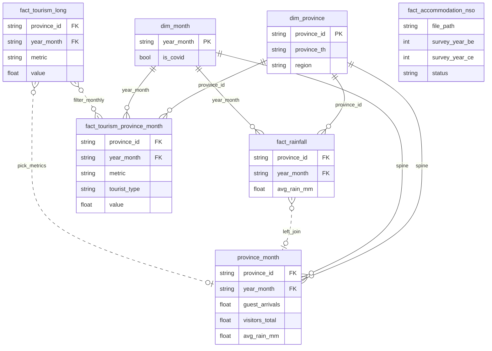
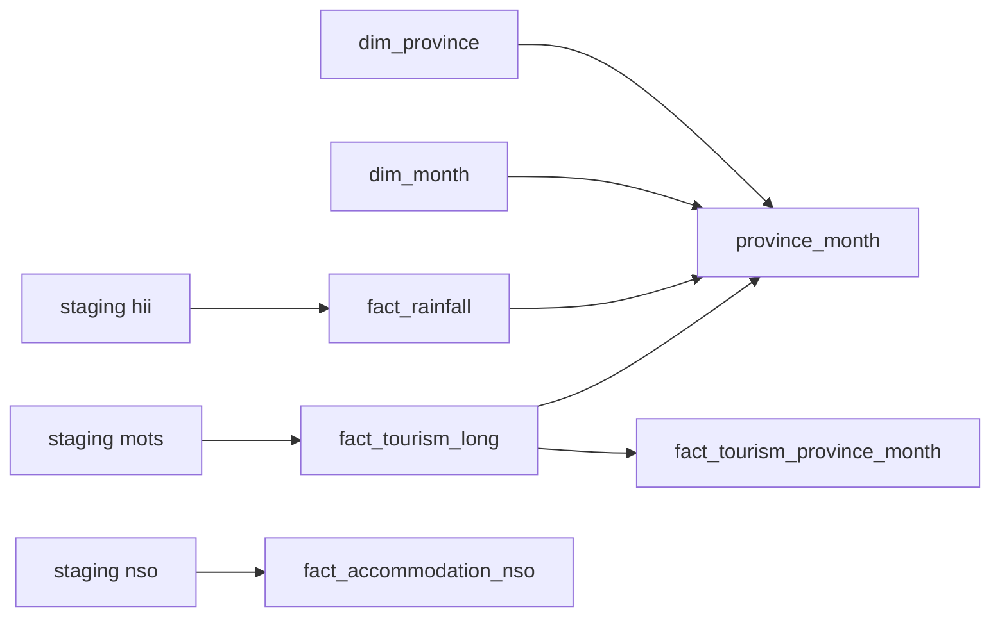

# พจนานุกรมข้อมูล

## ข้อตกลง

- **วันที่** ในตาราง core ใช้ `year_month` แบบ **ค.ศ.** (`YYYY-MM`) ยกเว้นระบุ `year_be` (พ.ศ.)
- **`is_covid`**: `true` สำหรับ `2020-03` ถึง `2022-12` (34 เดือน) เป็นช่วงที่โครงการกำหนด ไม่ได้แปลว่าเป็น causation

## ความสัมพันธ์ระหว่างตาราง

คีย์ตาม logic ใน `build_core` (ไฟล์ Parquet ไม่ได้ enforce FK). เส้นทึบ = join รายเดือน จังหวัด×เดือน เส้นประ = สืบทอดหรือ join แบบเลือกได้

**หมายเหตุ**

- `fact_tourism_long` มีแถว **รายไตรมาส** และ **sub_area** หลายแถวไม่มี `year_month`
- `fact_accommodation_nso` **ไม่** join เข้า `province_month` ในไปปไลน์นี้
- `province_month` = spine จาก dim × dim + ฝน + tourism สองคอลัมน์จาก long

## ตาราง core (`data/core/`)

| ตาราง | Grain | คำอธิบาย |
|-------|-------|----------|
| `dim_province` | province_id | 77 จังหวัด |
| `dim_month` | year_month | 2018-01 … 2025-08 พร้อม `year_be`, `is_covid` |
| `fact_rainfall` | province_id × year_month | ฝน HII (mm) |
| `fact_tourism_long` | แถวต่อ metric | MOTS รูปแบบ long |
| `fact_tourism_province_month` | จังหวัด × เดือน × metric × tourist_type | ท่องเที่ยวรายเดือนระดับจังหวัด |
| `fact_accommodation_nso` | ไฟล์ที่แตกแล้ว | บัญชี NSO (`survey_year_be`, `survey_year_ce`, `status`, `file_path`) ไม่ใช่รายเดือน |
| `province_month` | จังหวัด × เดือน | **เริ่ม DS/ML ที่นี่** |

### คอลัมน์ `province_month`

| คอลัมน์ | แหล่ง | หมายเหตุ |
|--------|--------|----------|
| `guest_arrivals` | MOTS รายไตรมาสภายในประเทศ | 2018–2025 ตามที่เผยแพร่ |
| `visitors_total` | MOTS รายเดือน `(R)` | โดยทั่วไป 2023-01–2025-08 |
| `avg_rain_mm` | HII | ครบทุกแถวของโครงสร้าง |

## Staging (`data/staging/`)

- `hii/fact_rainfall.parquet`
- `mots/fact_tourism_long.parquet`, quarantine CSVs
- `nso/fact_accommodation_nso_inventory.parquet`

## Manifest

`data/manifest/manifest_downloads.csv` — ที่มาแต่ละการดาวน์โหลด
